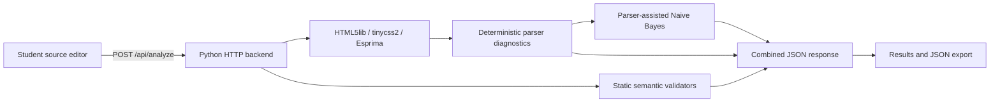

# Project submission guide

## Title

**ML-Based HTML-CSS-JavaScript Compiler for Intelligent Web Code Validation**

## Abstract

This project provides a local web application for validating HTML, CSS, and
JavaScript source. Language parsers report deterministic syntax diagnostics,
small static semantic checks look for cross-reference and identifier issues,
and a parser-assisted Multinomial Naive Bayes model ranks likely error
categories. The frontend keeps those three result types separate and can
export an analysis as JSON. The model was evaluated on a held-out synthetic
dataset; its reported metrics are not claims about real-world code accuracy.

## Problem statement

Syntax errors, invalid references, and missing declarations can be difficult to
locate when writing web code. A useful validator should identify concrete
parser findings, run understandable semantic checks, and explain where an ML
model can help without presenting a prediction as a proven error.

## Objectives

1. Accept HTML, CSS, and JavaScript source in one browser workspace.
2. Produce deterministic parser diagnostics with source locations when
   available.
3. Run focused static semantic checks for each supported language.
4. Use the trained ML model to rank likely error categories for each language.
5. Keep parser evidence, semantic warnings, and model predictions distinct.
6. Provide a local API, a JSON export, reproducible model information, and
   setup instructions.

## System architecture



The backend loads the checked-in model once at startup. `ErrorAnalyzer` parses
each submitted language, returns deterministic diagnostics, and passes those
diagnostic codes alongside source-token features to the classifier. Separate
static checks inspect selected HTML, CSS, and JavaScript relationships. The
frontend renders each result group independently.

## Technology and module map

| Component | Technology | Responsibility |
| --- | --- | --- |
| Frontend | HTML, CSS, JavaScript | Editor, examples, results, benchmark card, JSON export |
| Backend | Python standard library HTTP server | Static file serving, input validation, API responses |
| HTML parser | html5lib | Document and fragment parsing |
| CSS parser | tinycss2 | Stylesheet and declaration parsing |
| JavaScript parser | Esprima | ECMAScript 2017 script parsing and AST |
| ML model | Multinomial Naive Bayes | Top-k ranking of known error categories |
| Dataset and evaluation | Python, checked-in JSON/JSONL | Reproducible synthetic data, model selection, held-out metrics |

## Validation behavior

| Language | Deterministic parsing | Static semantic checks |
| --- | --- | --- |
| HTML | html5lib document/fragment parse findings | Duplicate IDs, missing image alt attributes, unresolved `label for`, same-page fragment links, and ARIA ID references |
| CSS | tinycss2 syntax findings and unmatched block/string diagnostics | `var(--name)` references with neither a definition in the submitted stylesheet nor a fallback |
| JavaScript | Esprima syntax findings | Identifiers not declared in the script or known browser/Node.js globals; skipped when syntax parsing fails |

These are focused static checks. They do not run submitted JavaScript, fully
model CSS cascade, resolve external modules, prove accessibility, or guarantee
browser/runtime behavior. Warnings are advisory and are not compiler verdicts.

## ML model and evaluation

- Algorithm: Multinomial Naive Bayes, trained separately by language.
- Features: source tokens plus deterministic parser diagnostic codes
  (`token_parser`).
- Smoothing: `alpha = 0.25`, selected using the validation split.
- Corpus: 2,664 synthetic examples; 1,773 train, 432 validation, 459 held-out
  test examples. Generated template families are kept within one split.
- Held-out synthetic test results: accuracy **93.25%**, macro-F1 **93.53%**.
- The current test results describe generated patterns only. They do not
  estimate accuracy on real student code or production repositories.

The frontend describes returned scores as model rankings. They are
uncalibrated Naive Bayes scores, not probabilities that a compiler will fail.
Model predictions remain separate from parser findings and semantic warnings.

## Running and checking the project

From the repository root in PowerShell, with Python 3.10 or newer:

```powershell
py -3 -m venv .venv
.\.venv\Scripts\python.exe -m pip install -r ml/requirements.txt
.\.venv\Scripts\python.exe -m backend
```

Open http://127.0.0.1:8000. Use **Clean sample**, **Semantic issues**, and
**Syntax errors** to demonstrate the three layers. Press **Ctrl+C** in the
terminal to stop the server.

Run the test suites in another terminal:

```powershell
.\.venv\Scripts\python.exe -m unittest discover -s ml\tests -v
.\.venv\Scripts\python.exe -m unittest discover -s backend\tests -v
```

The suites cover model behavior, parser diagnostics, semantic checks, API
response assembly, and loading evaluation metadata.

## Suggested demo sequence

1. Show the model card and state that its metrics use synthetic held-out data.
2. Load **Clean sample** and point out that valid code gets no parser or
   semantic findings while the model still returns a category ranking.
3. Load **Semantic issues** and show HTML references, an undefined CSS custom
   property, and an undeclared JavaScript identifier.
4. Load **Syntax errors** and show concrete parser findings. JavaScript
   semantic checks are skipped until its parse error is fixed.
5. Export the JSON report and explain that the response keeps evidence,
   warnings, and predictions separate.

## Test cases

| Case | Expected result |
| --- | --- |
| Valid HTML document | No fatal syntax finding; semantic checks report only inspected rules |
| Duplicate HTML ID or unresolved label target | HTML semantic warning with a line and column |
| CSS `var(--missing)` without definition/fallback | CSS semantic warning |
| JavaScript reference to undeclared identifier | JavaScript semantic warning |
| Malformed CSS or JavaScript | Deterministic parser finding; JavaScript semantic scan is skipped on syntax error |
| Empty request or invalid `top_k` | Clear JSON 4xx error |
| Valid request with all three languages | Parser, semantic, and top-k model result fields for all languages |

## Limitations and future work

- Replace or supplement synthetic training data with a licensed, reviewed,
  representative real-code dataset before making practical accuracy claims.
- Calibrate ML scores and add confidence intervals or abstention behavior.
- Expand semantic scope with project-aware JavaScript imports, more CSS
  validation, and HTML parsing tied to source locations.
- Add safe, opt-in suggested fixes after validating them against tests.
- The included HTTP server is for trusted local use, not public deployment.

## Viva preparation

**How is parsing different from semantic validation?** Parsing checks whether
source follows a language grammar. Semantic checks inspect selected relationships
that can be syntactically valid, such as an HTML label pointing to a missing ID
or a JavaScript identifier that was never declared.

**Why use both parsers and ML?** Parsers provide reproducible evidence for
supported syntax. The ML model can rank a known category from code features and
parser codes, but its output is advisory and does not replace the parser.

**What does 93.25% accuracy mean here?** It is the fraction of correct labels
on 459 held-out synthetic examples. It is not an estimate for real code.
Macro-F1 provides an average over classes so results are not dominated only by
the largest category.

**How did you avoid using test data to select the model?** Feature mode and
smoothing alpha were selected on the validation split. The final test split was
held out for evaluation.

**Does the application execute submitted JavaScript?** No. It parses source
text and inspects the AST; submitted source is never run.
